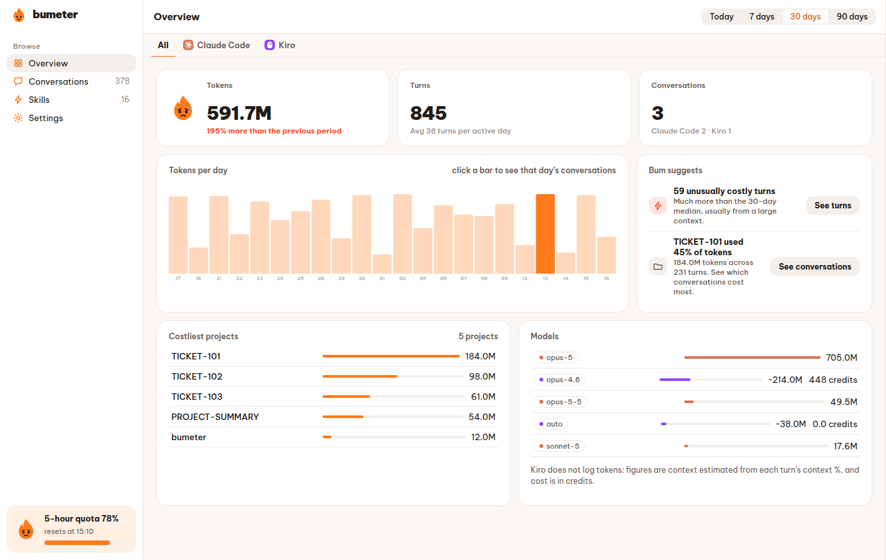
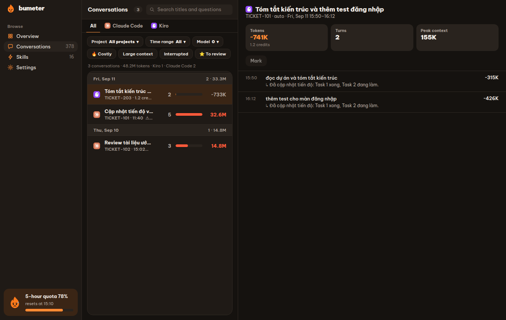
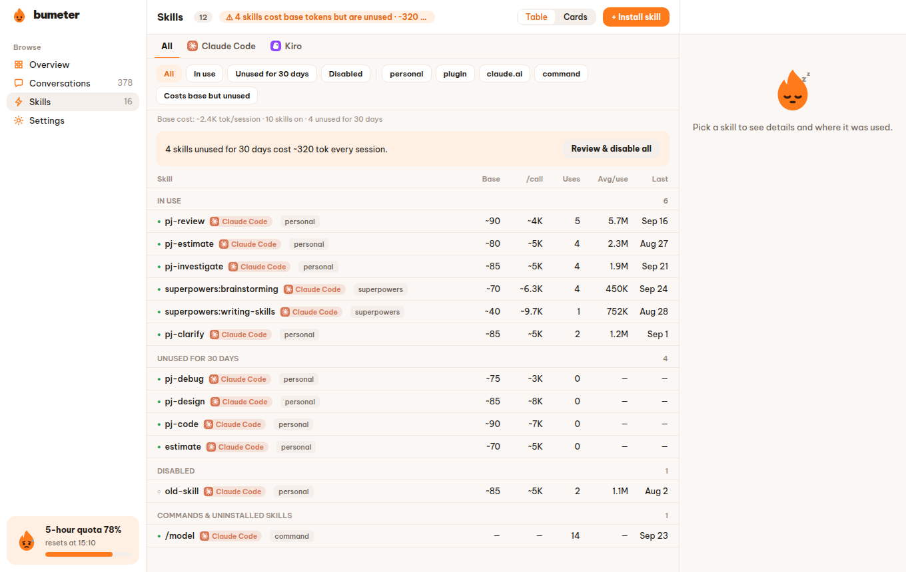

<p align="center">
  
</p>

<h1 align="center">Bumeter</h1>

<p align="center">See where your AI coding tokens go — per conversation, per turn, per skill — and how close you are to your limits.</p>

Bumeter is a desktop app for Linux that reads the local logs of AI coding assistants
(**Claude Code** and **Kiro** today) and turns them into something you can act on:
which conversations and turns were expensive, which skills cost tokens in every session,
and how much of your 5-hour, 7-day and monthly quota is left.

Everything is read from your own machine. Nothing is uploaded.



## Features

- **Tray with a quota bar per tool.** Bum, the mascot, changes face with your usage
  (calm, happy, worried, on fire, asleep), and the highest percentage sits next to it in the top bar.

  ```
  Claude Code
  ▰▰▰▰▰▱▱▱▱▱ 🟢  5 hours · 49% · reset 13:10
  ▰▰▰▰▰▰▰▰▰▱ 🔴  7 days · 90% · reset Oct 16
  Kiro
  ▰▰▰▱▱▱▱▱▱▱ 🟢  Month · 27% · 271/1000 credits · reset Nov 1
  ```
- **Overview** for today, 7, 30 or 90 days: tokens compared with the previous period,
  tokens per day, costliest projects and models, and suggestions from Bum
  (unusually costly turns, a project eating most of the budget, skills that cost tokens but are never used).
- **Conversations** grouped by day, with a fuel bar per conversation, filters
  (project, time range, model, costly, large context, interrupted, starred) and the full list of turns.
- **Context analysis** for a session: what fills the context window, when it was compacted, which tool calls were large.
- **Skills**: always-on token cost and real usage of every skill; install (also from
  [skills.sh](https://skills.sh)), disable, change size or remove, all with undo.
- **Per-tool tabs** on every screen, so adding Codex, Cursor or OpenCode later is one more tab, not a redesign.
- **Notifications** when a quota passes your thresholds (70% / 90% by default) or a turn costs far more than usual.
- **Light and dark themes**, Vietnamese and English.

| Conversations | Skills |
|---|---|
|  |  |

## Install

Bumeter needs a desktop with WebKitGTK 4.1, i.e. **Ubuntu 24.04 or newer** (or an equivalent distribution).

**Debian/Ubuntu package**

```bash
sudo apt install ./Bumeter_1.0.1_amd64.deb
```

This installs `bumeter` (the app) and `bum` (the command line tool) in `/usr/bin`.

**AppImage** (no install, libraries included)

```bash
chmod +x Bumeter_1.0.1_amd64.AppImage
./Bumeter_1.0.1_amd64.AppImage
```

**Snap** — the `bumeter` snap is waiting for the Snap Store's classic-confinement review.
Once it is published: `sudo snap install bumeter --classic`.

## How it gets the numbers

| Source | What Bumeter reads |
|---|---|
| Claude Code | Session logs in `~/.claude/projects/**` (tokens, turns, tools, skills). The 5-hour and 7-day quota comes from Claude Code's status line: Bumeter adds `bum statusline --tee` in front of your existing status line command in `~/.claude/settings.json` (with a backup and an undo button in Settings). |
| Kiro | Session files in `~/.kiro/sessions/cli/**`. Kiro does not log tokens, so context is estimated from each turn's context percentage, and cost is in credits. The monthly credit limit comes from `kiro-cli chat --no-interactive /usage`, run only when `kiro-cli` is installed and `kiro-cli whoami` says you are logged in. You can also type the limit in Settings. |

Tools that are not installed are simply not shown.

Data lives in `~/.local/share/bumeter/` (a SQLite database, `config.toml`, backups).
Older installs that used `~/.local/share/thongke/` are moved there automatically on first start.

## Command line

```
bum status       today's summary and quota bars from the running app
bum statusline   used by the Claude Code status line hook
bum scan         read the logs into the database without the app
bum daemon       run the background host without a window
bum session      context breakdown of one session
bum skills       always-on cost and usage of each skill
bum audit        compare Bumeter's token totals with an independent count
```

## Build from source

Requirements: Rust (stable), Node 20+, `libwebkit2gtk-4.1-dev`, `libayatana-appindicator3-dev`, `librsvg2-dev`.

```bash
cargo build --release -p bum-cli
mkdir -p app/src-tauri/binaries
cp target/release/bum app/src-tauri/binaries/bum-x86_64-unknown-linux-gnu
(cd app/ui && npm install && npm run build)
cd app && ./ui/node_modules/.bin/tauri build --bundles deb appimage
```

The packages land in `target/release/bundle/`. Snap: `snapcraft pack` (uses `snap/snapcraft.yaml`, built from the `.deb`).
More detail in [docs/build-ubuntu.md](docs/build-ubuntu.md).

Tests: `cargo test --workspace` and `cd app/ui && npx vitest run && npx tsc --noEmit`.

### CI and releases

- `.github/workflows/ci.yml` runs the Rust tests on Linux, macOS and Windows, plus the UI tests, on every push and pull request.
- `.github/workflows/release.yml` builds the installers: `.deb` + `.AppImage` (Ubuntu 22.04+), `.dmg` (Apple Silicon and Intel),
  `.exe` (NSIS) + `.msi` (Windows). Run it from the Actions tab to get the files as artifacts, or push a tag
  (`git tag v1.0.2 && git push origin v1.0.2`) to get a draft GitHub Release with the files attached.
  The macOS and Windows builds are not code-signed yet, so Gatekeeper and SmartScreen will warn on first launch.

### Project layout

```
crates/bum-core       database, ingestion engine, quotas, tray text, insights
crates/bum-adapters   log readers for Claude Code and Kiro, Kiro /usage
crates/bum-service    background host and IPC
crates/bum-skills     skill catalog, install/disable/remove with undo, skills.sh
crates/bum-cli        the `bum` command
app/src-tauri         the Tauri app: window, tray, notifications
app/ui                the interface (TypeScript, no framework)
docs/brand            Bum, the mascot, in five moods
```

## Tiếng Việt

Bumeter là app desktop cho Linux, đọc log của Claude Code và Kiro ngay trên máy để cho thấy
token tốn vào hội thoại, lượt hỏi và skill nào, cùng mức quota 5 giờ, 7 ngày và credit tháng còn lại.
Không gửi dữ liệu đi đâu. Giao diện có tiếng Việt và tiếng Anh (đổi trong Cài đặt).

Cài: `sudo apt install ./Bumeter_1.0.1_amd64.deb`, hoặc chạy thẳng file `.AppImage`.
Hướng dẫn build chi tiết: [docs/build-ubuntu.md](docs/build-ubuntu.md).

## Credits

Tool logos in `app/ui/public/tool-icons/` belong to their owners; see the
[NOTICE](app/ui/public/tool-icons/NOTICE.md) file there.
